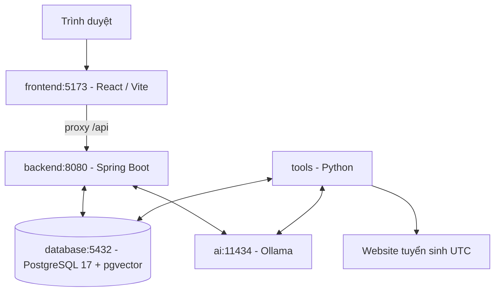

# Kiến trúc UTC RAG Chatbot

## Phạm vi

Backend đã triển khai REST API cho sáu nhóm chức năng, authentication/CSRF,
phân quyền, biên tập/xuất bản và gọi Ollama. Xem [hướng dẫn backend](../backend/README.md)
và OpenAPI trong backend. Frontend và Tools vẫn là scaffold; chưa có giao diện
chatbot hoặc worker crawler/index tài liệu. Database gồm 48 bảng ERD v2 và các
cột/index/view bổ sung phục vụ hợp đồng API, không seed dữ liệu.

Backend đã có truy vấn database và client Ollama. Frontend chưa gọi API;
các kết nối từ Tools là hướng phát triển worker tiếp theo.

## Năm services

| Service | Nền tảng và cấu hình | Vai trò tương lai |
| --- | --- | --- |
| `frontend` | React + TypeScript + Vite; tiêu đề tối thiểu, proxy `/api` | Website |
| `backend` | Java 21 + Spring Boot 3.5 + Spring Data JPA / Hibernate PostgreSQL | API và điều phối RAG |
| `tools` | Python 3.12; tiến trình chờ tín hiệu dừng | Crawler, xử lý và đồng bộ tài liệu |
| `database` | `pgvector/pgvector:0.8.7-pg17-trixie` | Dữ liệu nghiệp vụ và embeddings |
| `ai` | Một container `ollama/ollama:latest` | SLM và embedding chạy local |

Backend dùng Spring Data JPA/Hibernate và native SQL qua EntityManager, REST controller/service theo nhóm chức năng
và RestClient cho Ollama. Tools chưa cài thư viện crawler/database/AI; thêm các
dependencies khi triển khai worker. Vite dùng làm development server local.

## Network và environment

Tất cả services dùng network Compose `utc`, driver `bridge`, phân giải DNS bằng
tên service. Không dùng `localhost` để gọi container khác. Network không đặt
`internal: true` để Tools có thể truy cập website UTC và Ollama tải model.
Chỉ frontend/backend publish cổng lên loopback `127.0.0.1` của host.

| Biến | Ý nghĩa |
| --- | --- |
| `FRONTEND_PORT`, `BACKEND_PORT` | Cổng host, mặc định 5173 và 8080 |
| `POSTGRES_DB`, `POSTGRES_USER`, `POSTGRES_PASSWORD` | Database và credentials backend/tools |
| `SPRING_DATASOURCE_URL` | Compose tạo JDBC URL dùng `database:5432` |
| `POSTGRES_HOST`, `POSTGRES_PORT` | Tools dùng `database`, `5432` |
| `BACKEND_PROXY_TARGET` | Vite chuyển `/api` tới `http://backend:8080` |
| `OLLAMA_BASE_URL` | Backend/tools dùng `http://ai:11434` |
| `SLM_MODEL` | `qwen3:0.6b` |
| `EMBEDDING_MODEL` | `embeddinggemma:300m-qat-q4_0` |
| `EMBEDDING_DIMENSION` | Compose cố định 768 cho backend/tools |
| `UTC_SOURCE_URL` | Website tuyển sinh UTC; chưa có truy cập |

Trình duyệt sẽ gọi đường dẫn tương đối `/api` qua Vite proxy, không gọi hostname
Docker trực tiếp. Các biến nội bộ không được nhúng vào bundle frontend.
`.env` phục vụ Compose interpolation, không commit; `.env.example` là mẫu.

## Lưu trữ và khởi động

- `postgres_data`: `/var/lib/postgresql/data` cho PostgreSQL 17.
- `ollama_data`: `/root/.ollama`, lưu chung cả hai model.
- `document_uploads`: `/app/uploads`, lưu PDF đã nhận từ API nộp tài liệu.
- Thư mục SQL init mount read-only, bật extension `vector` và tạo 48 bảng theo ERD v2,
  không seed dữ liệu. Chỉ chạy tự động khi volume database rỗng; volume hiện có
  cần áp dụng schema một lần theo hướng dẫn database.
- Backend/Tools đợi database và AI healthy. Frontend đợi backend healthy;
  readiness backend bao gồm kiểm tra JDBC tới database.
- PostgreSQL healthcheck dùng `pg_isready`; Ollama dùng `ollama list`.
  Healthcheck không kiểm tra đã tải model hoặc đã bật extension.
- Pull model thủ công vào chính `ai`, không thêm service thứ sáu. Mặc định CPU.
- Không mount source, không scheduler, không tự tải model. Build lại sau khi sửa mã.

Dimension 768 được cố định ở cột `document_chunks.embedding vector(768)`;
chưa có mã tạo embedding. Cần giữ thống nhất model/dimension khi phát triển.
Tag Ollama `latest` có thể thay đổi; nhóm có thể pin tag/digest sau khi xác nhận
phiên bản hoạt động. Runtime local sau khi tải images/dependencies/models;
crawler tương lai vẫn cần Internet để đọc website UTC.

## Tham khảo

- [pgvector Docker và extension](https://github.com/pgvector/pgvector)
- [EmbeddingGemma Q4](https://ollama.com/library/embeddinggemma:300m-qat-q4_0)
- [Spring Boot 3.5 system requirements](https://docs.spring.io/spring-boot/3.5/system-requirements.html)

# Backend persistence

Controller → Service → Repository → PostgreSQL. Xem [kiến trúc Spring Data JPA](backend-persistence.md)
để phân biệt CRUD/JPQL, custom native query và trách nhiệm từng tầng.
