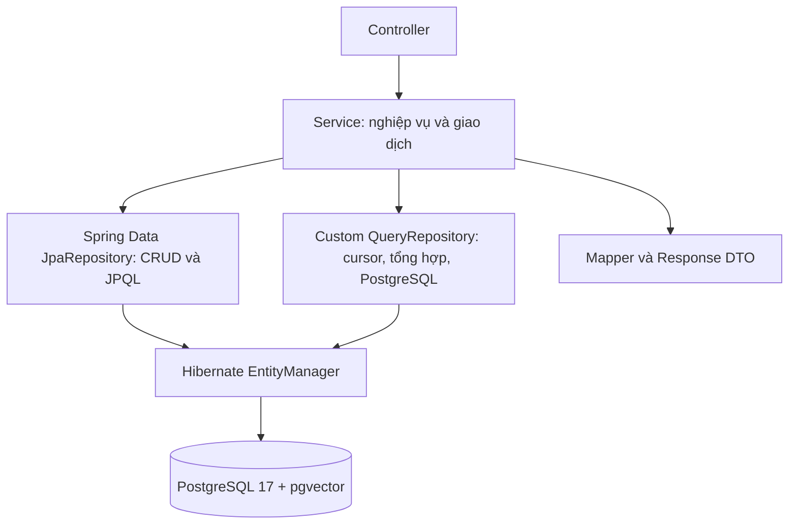

# Kiến trúc persistence của backend

## Trách nhiệm

- Controller ánh xạ HTTP và gọi service. Các lớp `ChatService`, `OpsService`,
  `ProgramService`, `ScoreRuleService` chứa phần điều phối trước đây nằm trong
  controller. Một số service vẫn nhận request để sử dụng phiên và quyền hiện tại.
- Service giữ luật nghiệp vụ, kiểm tra quyền, ETag và ranh giới `@Transactional`.
  Không truyền câu SQL xuống repository.
- Service gọi trực tiếp repository JPA, không đi qua lớp bọc CRUD. Các lớp
  `*QueryRepository` chỉ giữ truy vấn đặc thù và đều nằm trong
  `persistence/repository/query`. Không nhận servlet request; đọc phân trang dùng
  `QueryPage`, còn phạm vi quyền dùng `CampusScope`.
- `persistence/repository` chứa 48 interface Spring Data JPA ánh xạ 48 entity.
  Các thao tác tạo dùng `save`/`saveAndFlush`; tìm theo ID dùng `findById`, các bộ lọc
  đơn giản dùng derived query. Repository nhận tham số có kiểu, không dùng map tham số
  hoặc truy vấn trùng theo từng caller. Join/projection và bulk delete dùng JPQL.
  `EditorialMapper` dựng entity bằng setter cụ thể, không lưu dữ liệu;
  `EditorialService` gọi repository tương ứng và quản lý năm nhóm phiên bản.
- `mapper/common/EntityMapper` tạo projection giữ hợp đồng JSON hiện tại, bao gồm ID dạng chuỗi.
  Một số custom repository tại ranh giới API vẫn dùng map tham số/projection để giữ
  hợp đồng; các interface Spring Data đã dùng tham số có kiểu. Role và option join
  dùng record projection. Quản trị tài khoản dùng `AccountResponse`, `RoleResponse`,
  `IdResponse` và `AccountMapper`; các response linh hoạt khác vẫn giữ projection
  dạng map để không thay đổi API. Mapper không có repository, EntityManager hoặc
  transaction. `AuditService` thực hiện ghi audit qua `AuditEventsRepository`.

## Ranh giới native SQL

Ưu tiên repository có sẵn và derived query trước khi viết JPQL. Lọc động dùng
Specification như luồng kiểm tra revision theo cơ sở. Các truy vấn tìm theo ID,
lọc/sắp xếp, đếm đơn giản và xóa theo thuộc tính không còn `@Query`.
JPQL giữ lại cho ba nhóm: tổng hợp lấy số phiên bản/vị trí tiếp theo hoặc đếm ADMIN,
join/projection và bulk delete có subquery hoặc đồ thị tin nhắn tự tham chiếu.
Tin nhắn trong một hội thoại được xóa bằng một câu lệnh để không vi phạm khóa ngoại
`reply_to_id` khi xóa từng entity. Các thao tác cập nhật từng entity dùng
setter và dirty checking. Xóa bằng derived query được flush trước khi thêm lại
các bản ghi con để giữ thứ tự khóa ngoại và ràng buộc unique.

`@Lock` nằm trên phương thức truy vấn abstract, không đặt trên default method chỉ
ủy quyền gọi truy vấn. `ArchitectureTest` bảo vệ quy tắc này và ngăn đưa JPQL CRUD
đơn giản trở lại.

Native SQL được giữ trong custom repository cho truy vấn tổng hợp công khai,
phân trang cursor, khoảng cách vector, upsert và khóa bảng để bảo vệ ADMIN cuối cùng.
CRUD phiên bản biên tập dùng entity và dirty checking, không ghép tên bảng/cột để
tạo câu UPDATE. Kiểm tra quyền truy cập các revision dùng JPA Specification.
Metadata tên bảng/cột xuất phát từ cấu hình cố định; giá trị dùng parameter binding.
`NativeSqlExecutor` gom chi tiết EntityManager và flush/clear sau ghi để tránh entity
đã quản lý bị cũ. Không sử dụng wrapper này từ service/controller.

## Quy ước dữ liệu và giao dịch

JSONB dùng Hibernate JSON, vector dùng Hibernate vector với 768 chiều. Khóa ghép
dùng `IdClass`; khóa ngoại hiện là ID scalar, không cascade ngầm. Entity UUID có
`Persistable` để Spring Data nhận biết đối tượng mới với ID được cấp trước.
`ddl-auto=validate` chỉ kiểm tra schema; SQL trong `database/init` quản lý schema.
`open-in-view=false` đóng persistence context ngoài giao dịch. Các luồng cập nhật
draft, xuất bản, tài khoản, tiêu đề hội thoại và hoàn tất trắc nghiệm sửa managed
entity bằng setter. Luồng xuất bản flush bản cũ sang ARCHIVED trước khi chuyển bản
mới sang PUBLISHED để giữ ràng buộc unique trong PostgreSQL.

## Kiểm chứng

Chạy `powershell -NoProfile -ExecutionPolicy Bypass -File backend/scripts/test.ps1`
từ gốc repository. Script dùng database kiểm thử riêng rồi dọn database đó.
`ArchitectureTest` ngăn SQL/EntityManager trong controller/service và ngăn repository
phụ thuộc servlet request. Bộ integration test kiểm tra ánh xạ entity, khóa ghép,
vector, vô hiệu cache sau native mutation và các luồng API đang có.
Kiểm thử còn flush/clear rồi đọc lại trạng thái, kiểm tra xuất bản thay thế ở cả năm
nhóm biên tập và cấm tham số Map trong interface Spring Data.
